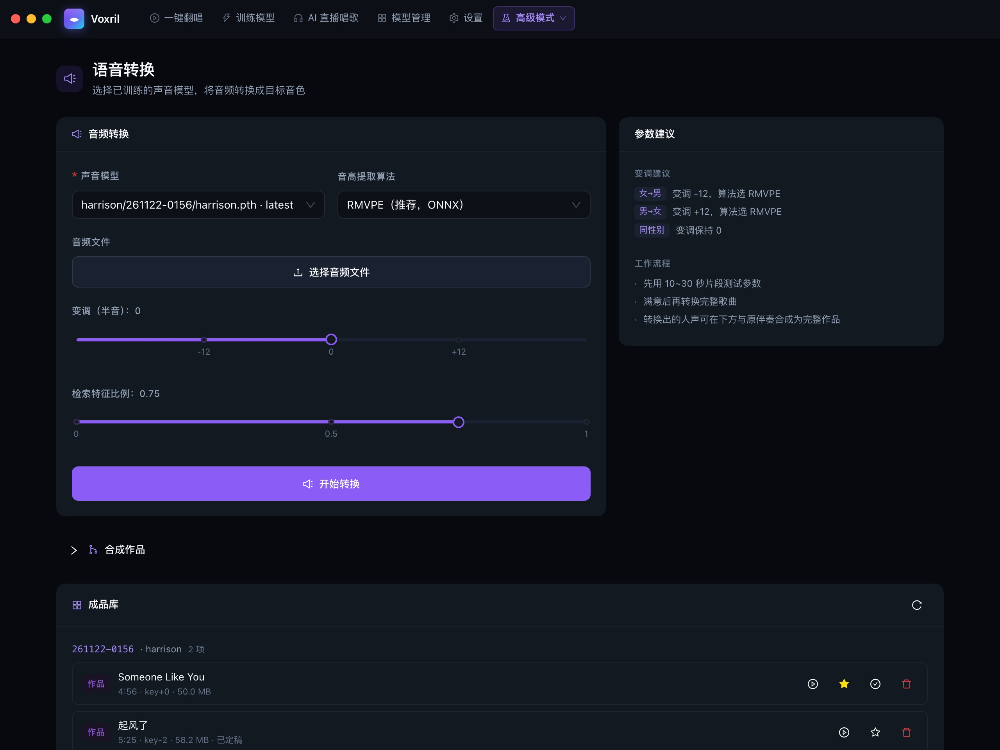
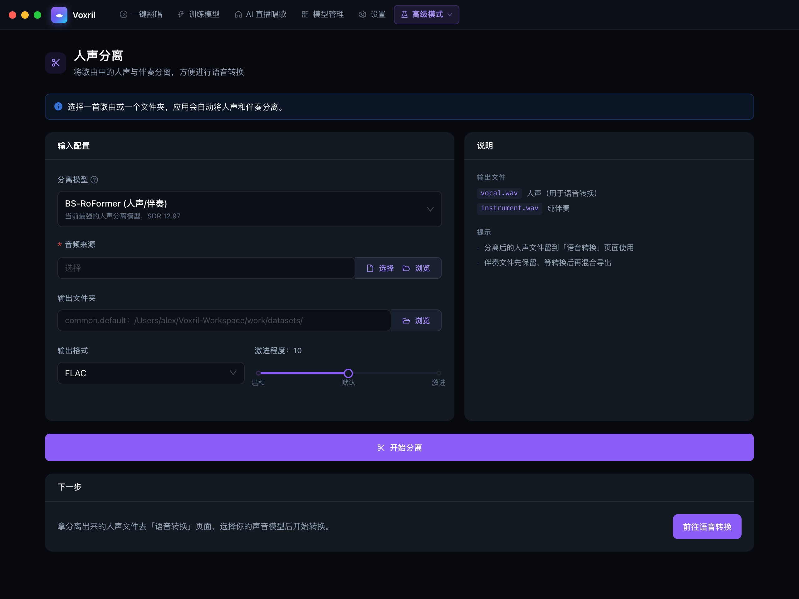
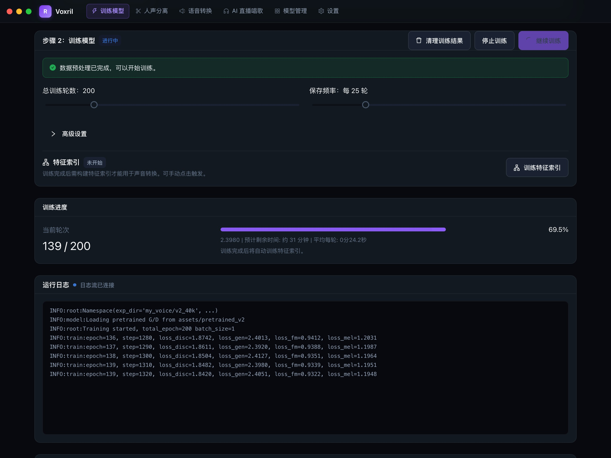

<div align="center">

# 🎙️ Voxril

**Turn any song into a cover sung in your own voice — entirely offline.**

Pick a song, split it into vocals and instrumental, swap the vocals for a voice you like, and put it back together as a finished cover file. Everything runs on your Mac — no cloud, no account, no subscription.

<p>
  <a href="https://github.com/Harrison-Yuan/Voxril/releases">
    
  </a>
  <a href="#-three-steps-to-your-first-cover">
    
  </a>
  <a href="LICENSE">
    
  </a>
</p>

<p>
  
  
  
  
  
  <a href="README.zh.md"></a>
</p>

</div>

<p align="center">
  
</p>

```
🎵 a song ─▶ ✂️ split vocals / instrumental ─▶ 🔄 swap vocals for your voice ─▶ 🎚 back on the music ─▶ 🎧 your cover.wav
```

You don't need to understand the AI. Every screen has one obvious button, and anything you don't understand can stay at its default.

---

## 🎬 Three steps to your first cover

About five minutes, and you don't need to train anything first.

### Step 1 · Split the song

Go to **人声分离 (Separate)** → click the file button and pick your song → click **开始分离**.

You get two halves: `vocals` (voice only) and `instrumental` (music only), both in your workspace.

<p align="center">
  
</p>

### Step 2 · Swap the voice

Go to **语音转换 (Convert)**:

| Field | What to do |
|---|---|
| 声音模型 | Pick any voice from the list |
| 音频文件 | Choose the vocal file produced in step 1 |
| Everything else | **Leave it alone** — the defaults are fine |

Click **开始转换** and wait. The converted vocals land in the `converted` folder.

### Step 3 · Put it back on the music

Stay on the same page, scroll down and expand **合成伴奏 (Merge)** → click **合成**.

The finished cover is written to the `mixed` folder as `merged_....wav`. Double-click it to listen, and that's the file you share.

> **Where are my files?** Everything lives in one workspace folder, which you choose in **设置 (Settings)**. Open that folder in Finder to find `separated/`, `converted/` and `mixed/`.

---

## 📥 Install it (first time only)

1. Download the latest `.dmg` from [Releases](https://github.com/Harrison-Yuan/Voxril/releases), drag **Voxril** into **Applications**, and open it.
2. If macOS refuses to open it (this happens with unsigned builds), paste this into Terminal (`⌘ + Space` → type `Terminal`):

   ```bash
   xattr -dr com.apple.quarantine /Applications/Voxril.app
   ```

3. The first launch sets everything up by itself — it installs its Python environment and downloads the models (~1 GB). Progress is shown in the app; **don't quit while it's running**.
4. In **设置 (Settings)** pick a folder for your workspace (e.g. a new "Covers" folder on your Desktop), then restart the app.
5. Open **模型管理 (Models)** — every row should be a green **已就绪**. Anything red needs a click on **下载**.

**Before you start you need:** an Apple Silicon Mac (M1–M4) on macOS 14+, Python 3.10+ installed ([python.org](https://www.python.org/downloads/)), ~6 GB of free disk, and internet for that first setup.

---

## 🎤 Make it sound like *you*

Training is optional — the workflow above already works with any voice model. Train once and you can sing anything in your own voice.

1. **Record 10–30 minutes of your voice.** Singing or talking, a phone is fine — but no music, no echo, no noise.
2. **Put the recordings in one folder**, e.g. `Desktop/my voice`.
3. **Open 模型训练 (Train)** — the page you land on after launch:
   - **实验名称**: any name, e.g. `myvoice`
   - **训练集路径**: click **选择文件夹** and choose the folder from step 2
   - **采样率 / 音高算法 / 并行进程数**: don't touch them
   - Click these three buttons in order, waiting for each to finish: **开始数据预处理** → **F0 特征提取** → **音频特征提取**
   - Finally click **开始训练模型** and leave the Mac alone (hours, not minutes — start it before bed)
4. When it finishes, go back to **语音转换**: your voice now appears in **声音模型**. Use it exactly like step 2 above.

<p align="center">
  
</p>

Later, manage everything from **模型管理 (Models)** — base models, your trained voices, and models you import from elsewhere.

---

## 👶 Never used AI tools before?

Five words that appear everywhere in the app:

| Word | Plain meaning |
|---|---|
| 模型 / voice | A "voice file" — e.g. your own voice |
| 训练 (train) | Let the app listen to you and remember your voice |
| 分离 (separate) | Split a song into "instrumental only" and "vocals only" |
| 转换 (convert) | Replace someone's singing with another voice |
| 合成 (merge) | Put the new vocals back on the instrumental to make a full song |

**Three things worth knowing**

- A slow first launch and a long download are normal — don't keep quitting and reopening.
- Your Mac gets warm and the fans spin during training. That's expected.
- Everything runs on your own machine; your audio is never uploaded.

**Beginner FAQ**

| Question | Answer |
|---|---|
| Can I skip installing Python? | No — install Python 3.10+ first, then restart Voxril |
| macOS won't open the app | Use the Terminal line above, or right-click the icon → **Open** |
| How long does training take? | Depends on your data and Mac; it's long — start it before bed |
| Can I stop halfway? | Training resumes from the last checkpoint; don't quit during the first model download |
| The result sounds off-key | Set **变调** back to 0, then try ±1; if it still sounds odd, lower **检索特征比例** |
| Can I use covers commercially? | The code is open source; the song belongs to its rights holders — check the licensing yourself |

---

## 🧩 What each option means

Open this only when you're curious — the defaults work for almost everyone.

### 人声分离 (Separate)

| Option | Meaning | Suggested |
|---|---|---|
| 分离模型 | Which separation model to use | `BS-RoFormer` for general use; the MDX-Net variants isolate lead vocals or strip backing harmonies |
| 音频来源 | A single song or a whole folder | Single song for a quick test |
| 输出文件夹 / 格式 | Where and in what format to write results | Default folder; FLAC (lossless) |
| 激进度 | How aggressively the model removes bleed | 10 |

### 模型训练 (Train)

| Option | Meaning | Suggested |
|---|---|---|
| 实验名称 | The name of this voice | Anything you'll recognise |
| 训练集路径 | Folder with your recordings | The folder from step 1 |
| 目标采样率 | Audio resolution the voice is trained at | `40k` for singing, `32k` for speech, `48k` for maximum quality |
| 音高提取算法 | How pitch is tracked | `RMVPE`; `Harvest` for low voices, `PM` for speed |
| 并行进程数 | How many CPU workers preprocess your audio | 4 (raise it on Apple Silicon) |
| 总训练轮数 / 保存频率 | How long to train and how often to save | 200 / every 25 |
| 特征索引 | Makes the result sound like the target voice | Build it (automatic after training) |

Output: `experiments/<name>/v2_40k/` — `G_*.pth` (the voice) and `added_*.index` (retrieval index).

### 语音转换 (Convert)

| Option | Meaning | Suggested |
|---|---|---|
| 声音模型 | Which voice to sing with | The one you trained or imported |
| 音高提取算法 | Pitch tracking method | `RMVPE` |
| 变调（半音） | Pitch shift | `0` same gender, `-12` female→male, `+12` male→female |
| 检索特征比例 | How strongly the model sticks to the trained timbre | `0.75`; lower if unstable, higher for a closer match |

Output: `converted/` — `<song>_<model>_key<n>_<f0>.wav`.

### 合成伴奏 (Merge)

| Option | Meaning | Suggested |
|---|---|---|
| 新的人声音频 | The converted vocal | Auto-filled |
| 伴奏音频 | The instrumental from step 1 | Auto-detected; use **快速** to pick it manually |
| 输出文件夹 | Where the cover is written | `<workspace>/mixed` |
| 人声音量 (dB) | Vocal level against the music | 6 dB |

Output: `mixed/merged_*.wav`.

### 💡 Tips

- Keep the dataset dry: no reverb, no music bed, consistent mic distance.
- A 40k voice usually sounds better on sung material than 32k.
- If the cover sounds off-key, nudge **变调** by one semitone before re-training.
- More epochs isn't always better: 200–400 is enough for a small dataset, beyond that the model overfits.
- Keep your `G_*.pth` files — they are your voice backups.

---

## 💡 Why not just use a cloud voice service?

| The usual pain | Voxril |
|---|---|
| Monthly fees, and your audio is uploaded | Free for personal and noncommercial use, fully offline |
| RVC lives in a Gradio page stitched together with scripts and ffmpeg | One native app: separate → convert → merge → export |
| Converting vocals is easy, finishing a cover is manual work | The built-in merge step writes the finished file for you |
| Training a voice normally needs a big dataset | The RVC v2 pipeline trains from a few minutes of clean vocals |
| Models, indexes and logs scattered in folders | One workspace with a model manager |

---

## 🧭 How it works

```
song ──▶ vocal separation ─┬─▶ vocals ──▶ HuBERT + F0 ──▶ RVC v2 ──┐
                           └─▶ instrumental ──────────────────────┴─▶ cover file
```

<details>
<summary><b>Requirements &amp; platform support</b></summary>

| Item | Detail |
|---|---|
| OS | macOS 14 (Sonoma) or newer |
| Chip | Apple Silicon (M1–M4). **Intel Macs are not supported** — the bundled `ffmpeg` is arm64 and MPS requires Apple Silicon |
| Python | 3.10+ installed on the system. The app does **not** bundle a Python runtime |
| Disk | ~6 GB free (Python venv ≈4 GB + base models ≈1 GB) |
| Network | Needed on first launch (PyPI, HuggingFace, UVR model repos) |

| Platform | Status |
|---|---|
| macOS 14+ · Apple Silicon (M1–M4) | ✅ Supported — official DMG, PyTorch MPS acceleration |
| Windows 10/11 · x64 | 🚧 Reserved — build/config/CI slots are prepared, runtime adaptation is pending |

</details>

<details>
<summary><b>Architecture &amp; module map</b></summary>

```
┌─────────────────────────────────────────────────────────┐
│                   Desktop Shell (Tauri 2)                │
│  ┌──────────────┐  ┌──────────────┐  ┌────────────────┐ │
│  │  React SPA   │◀─▶  Rust Core   │◀─▶  Python Engine  │ │
│  │  (Vite + TS) │  │  (Commands)  │  │  (PyTorch MPS)  │ │
│  └──────────────┘  └──────────────┘  └────────────────┘ │
└─────────────────────────────────────────────────────────┘
```

| Layer | Technology | Purpose |
|---|---|---|
| Frontend | React 19 + TypeScript + Vite 8 | UI, Ant Design 6 dark theme, Zustand state, React Router |
| Rust core | Tauri 2 commands | file/workspace handling, audio decoding, merge & export, SQLite history, process control |
| Python engine | PyTorch MPS + ONNX Runtime | RVC v2 inference, training pipeline, vocal separation (`audio-separator`) |

**Workspace layout:** `experiments/<name>/v2_<sr>/` (training data, `G_*.pth`, `added_*.index`) · `separated/vocals`, `separated/instrumental` · `converted/` · `mixed/`.

</details>

<details>
<summary><b>Development &amp; release</b></summary>

Prerequisites: Rust toolchain, Node 20+, pnpm 10+, Python 3.10+.

```bash
git clone https://github.com/Harrison-Yuan/Voxril.git
cd Voxril

# Python side — `pnpm build` runs tools/verify_build_deps.py --quick against this venv
python3 -m venv .venv && source .venv/bin/activate
pip install -r requirements.txt

# Frontend dependencies (pnpm workspace includes web/)
pnpm install

# Tauri CLI
cargo install tauri-cli --version "^2"   # or: npm install -g @tauri-apps/cli@^2

pnpm dev    # Vite on :1420 + the Tauri window
pnpm build  # bumps the patch version, then builds the .dmg
```

**Releasing:** push a `v*` tag — or run the **Release** workflow manually to rebuild an existing tag. [release.yml](.github/workflows/release.yml) builds the `.app` with the Tauri CLI, wraps it into a DMG with `hdiutil`, takes the version from the tag, publishes the Release with a `SHA256SUMS.txt`, and signs + notarizes the build when the Apple secrets are configured (so users can double-click it). See [docs/releasing.md](docs/releasing.md) for the secrets, the cold-start checklist and troubleshooting.

</details>

---

## 🧪 Experimental: live singing

The `/live` page (mic → RVC → retune → accompaniment, plus the floating lyrics window) is still under development and has known bugs. Use the offline cover workflow above; live mode may glitch, drop out or fail to start.

---

## ⚠️ Known limitations

- **Apple Silicon only** — no Windows / Linux build yet
- The DMG is **unsigned and not notarized**, so Gatekeeper warns on first open
- Base models are **not committed to git** (size / licensing); they download on first launch
- First-run setup needs network access and an existing Python 3.10+ install
- **Live singing is experimental** and not recommended for production use

---

## 🗺 Roadmap

- [x] Voice model training (preprocess → feature extraction → train → index)
- [x] Vocal separation (BS-RoFormer + MDX-Net)
- [x] Offline voice conversion (PyTorch MPS + ONNX)
- [x] Merge converted vocals with the instrumental and export
- [ ] Stabilize real-time singing and the desktop lyrics window
- [ ] Bundle a Python runtime so users don't need to install Python
- [ ] One-click onboarding wizard for first-time users
- [ ] Pre-trained voice gallery (download & sing)
- [ ] Windows support

---

## 🤝 Contributing

Voxril is developed in the open and pull requests are genuinely welcome — including small ones.

| I want to… | Start here |
|---|---|
| Report a bug | Open a **Bug report**; the template asks for the details needed to reproduce it |
| Suggest a feature | Open a **Feature request** and describe the problem before the solution |
| Fix something small | [Good first issues](docs/contributor-tasks.md) — UI copy, i18n, docs, tests |
| Change models or audio quality | Open an issue first; these changes are discussed before code |
| Build a Windows port | Build config is already reserved, the runtime work is open |

- [CONTRIBUTING.md](CONTRIBUTING.md) covers the dev setup, the pre-PR checks and the PR rules
- UI-only changes can be developed in a browser: `pnpm -C web dev`, no models or Python venv needed
- Expect a first response within about a week
- ⭐ Star the repo, or share it with someone who wants a local AI cover tool

---

## 🙏 Acknowledgements

- **RVC — Retrieval-based Voice Conversion WebUI** (MIT): `infer/lib/infer_pack`, UVR5 separation code
- **UVR / BS-RoFormer** model repositories
- **HuBERT / ContentVec**, **RMVPE**, **FCPE** model authors

Upstream license notices are collected in [`MIT协议暨相关引用库协议`](MIT协议暨相关引用库协议).

---

## 📄 License

**PolyForm Noncommercial 1.0.0** — free to use, modify and share for any **noncommercial** purpose: personal study, hobby projects and research, plus noncommercial organizations such as schools, charities and public institutions.

**Commercial use requires a written license.** Using Voxril in a commercial product or service, or building a business on it, needs a separate commercial license — get in touch via [GitHub](https://github.com/Harrison-Yuan) to talk about licensing or cooperation.

RVC-derived parts keep their original MIT terms; see [`MIT协议暨相关引用库协议`](MIT协议暨相关引用库协议). Because of the noncommercial restriction, Voxril is **source-available**, not OSI-approved open source.

---

<div align="center">

**Built with ❤️ for the AI music community**

[](https://star-history.com/#Harrison-Yuan/Voxril&Date)

### ⭐ If Voxril is useful to you, star the repo. It helps more people find it.

</div>
