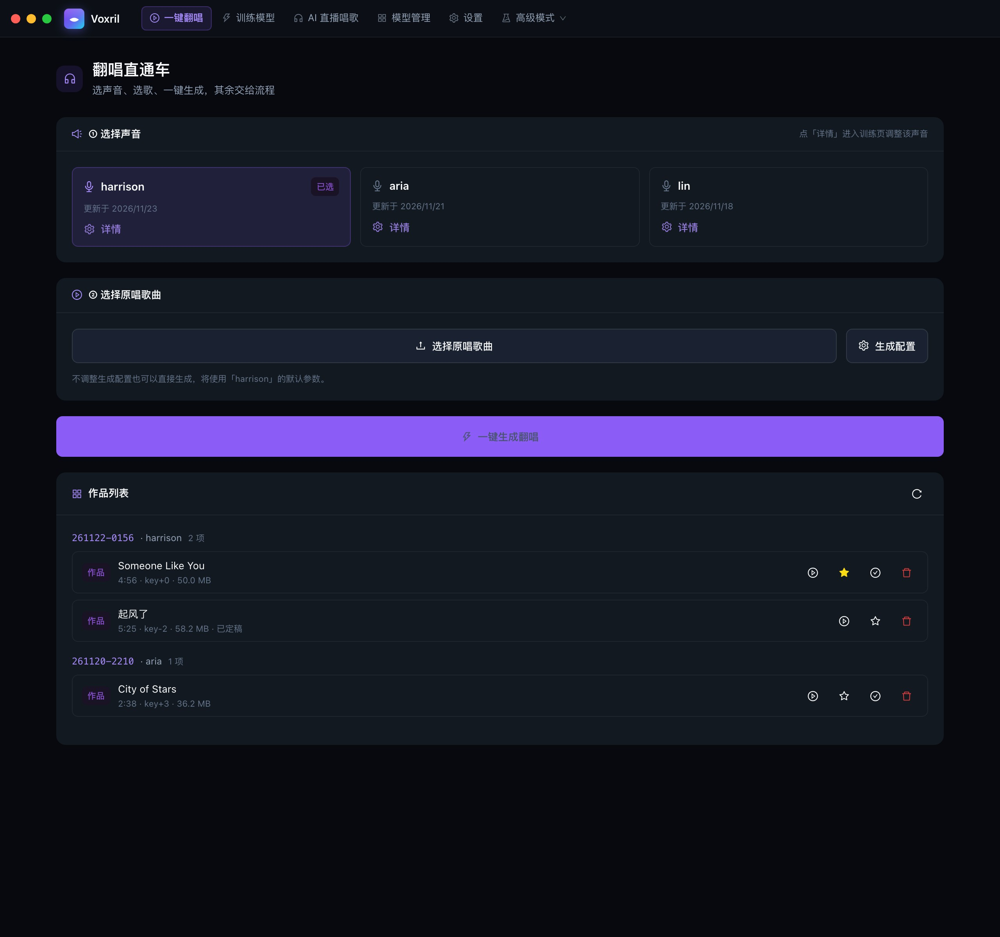
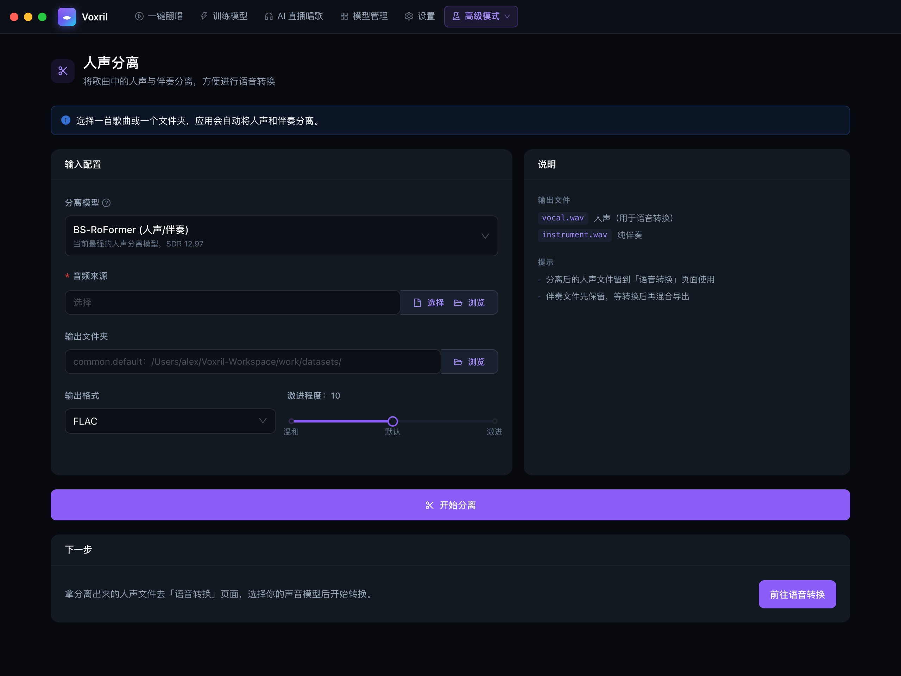
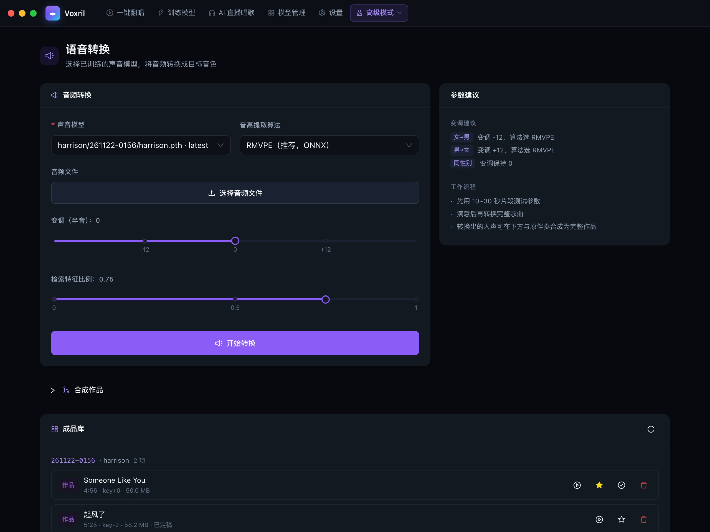
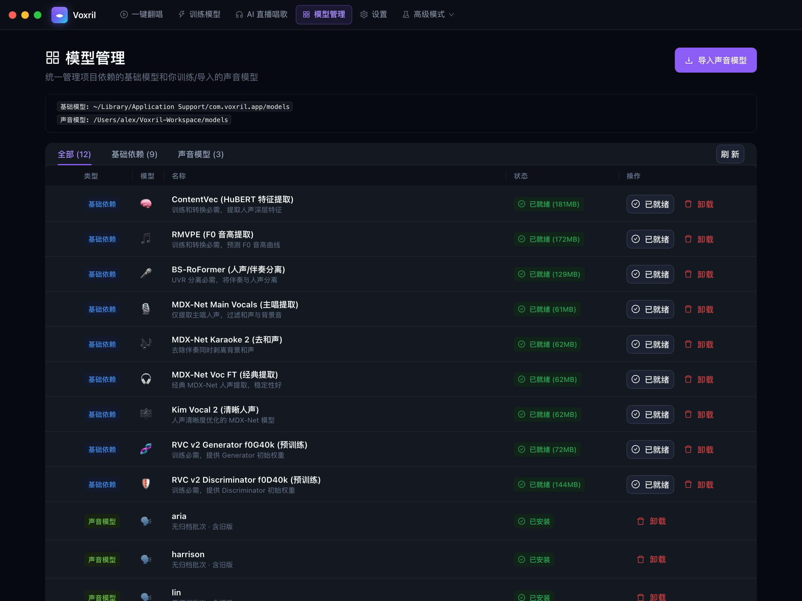

<div align="center">

# 🎙️ Voxril

**用自己的声音翻唱任何歌 —— 全程离线跑在这台 Mac 上。**

选一个音色、选一首歌、点一下。Voxril 会自动拆出人声、把歌声换成你的声音、再贴回伴奏，导出完整的翻唱文件。所有处理都在你自己电脑上完成：不上传、不注册、不订阅。

<p>
  <a href="https://github.com/Harrison-Yuan/Voxril/releases">
    
  </a>
  <a href="#-三步做出一首翻唱">
    
  </a>
  <a href="LICENSE">
    
  </a>
</p>

<p>
  
  
  
  
  
  <a href="README.md"></a>
</p>

</div>

<p align="center">
  
</p>

```
🎵 一首歌 ─▶ ✂️ 拆成人声 + 伴奏 ─▶ 🔄 歌声换成你的音色 ─▶ 🎚 贴回伴奏 ─▶ 🎧 你的翻唱.wav
```

不需要懂 AI。每个界面只有一个明显的按钮，看不懂的选项保持默认就行。

---

## 🎬 做第一首翻唱

Voxril 启动后就停在 **一键翻唱** 页。点一个按钮，它会自动跑完整条流程：分离人声 → 转换音色 → 合成作品。

**先要有一个声音** —— 可以[训练自己的](#-让它唱出你自己的声音)（录 10–30 分钟），也可以在 **模型管理** 里导入别人的 `G_*.pth`。准备好之后，以后每首歌都只要点一下。

1. **① 选择声音** —— 点一下顶部的音色卡片。
2. **② 选择原唱歌曲** —— 点 **选择原唱歌曲**，选 `mp3`、`wav`、`flac`、`m4a` 都行。
3. **③ 点 一键生成翻唱** —— 进度卡片会依次显示三个阶段。

跑完后，成品会出现在 **翻唱作品** 卡片里，可以直接播放；它同时会进入 **作品列表**，在那里可以加星标、**定稿**（移到永久的 `outputs/final` 文件夹）或删除（先移入回收站，7 天后自动清除）。

可选的 **生成配置** 会打开调参抽屉：变调、音高提取算法、检索特征比例、人声音量。配置按音色保存，绝大多数人不用打开。

<details>
<summary><b>想自己一步步操作？（高级模式）</b></summary>

顶栏的 **高级模式** 菜单里是手动分步：**人声分离** 和 **语音转换**。

### 1 · 把歌拆开

打开 **人声分离** → 点文件按钮选一首歌 → 点 **开始分离**。跑完之后会得到两份文件：`vocals`（只有人声）和 `instrumental`（只有伴奏）。

<p align="center">
  
</p>

### 2 · 换掉歌声

打开 **语音转换**：

| 这一栏 | 怎么填 |
|---|---|
| 声音模型 | 从列表里随便选一个音色 |
| 音频文件 | 选第 1 步得到的那个「只有人声」的文件 |
| 其他所有选项 | **都不用动**，默认值就是对的 |

点 **开始转换** 等它跑完。

<p align="center">
  
</p>

### 3 · 贴回伴奏

还在这个页面，往下滚，点开 **合成作品** → 点 **合成**。成品会写进成品库。

</details>

> **文件在哪？** 所有东西都放在 **设置** 里选定的「工作区」文件夹。旧工作区是平铺目录（`separated/`、`converted/`、`mixed/`、`experiments/`）；**设置 → 工作区布局** 可以一键迁移到新的四层结构（`inputs/`、`work/`、`outputs/`、`models/`）。

---

## 📥 先把它装上（只需一次）

1. 到 [Releases](https://github.com/Harrison-Yuan/Voxril/releases) 下载最新 `.dmg`，把 **Voxril** 拖进「应用程序」，双击打开。
2. 如果系统不让打开（未签名版本会出现），打开「终端」（`⌘ + 空格` 搜索 `终端` / `Terminal`），把下面这一整行粘进去回车：

   ```bash
   xattr -dr com.apple.quarantine /Applications/Voxril.app
   ```

3. 第一次打开它会用内置 Python 运行时创建环境、下载模型（约 1 GB），进度会显示在界面里；**这段时间别关掉它**。如果下载卡住或失败（国内网络访问 `huggingface.co` 或 PyPI 经常如此），打开 **设置 → 模型与依赖下载源**：模型选 **国内镜像**，Python 依赖选 **清华镜像**；模型下载中断后再次下载会从断点继续。
4. 打开 **设置**，选一个文件夹作为工作区（比如桌面上新建一个「翻唱」），然后重启应用。
5. 打开 **模型管理**，每一行都显示绿色 **已就绪** 就说明准备好了；有红色的点 **下载**。

**开始之前你需要：** Apple 芯片的 Mac（M1–M4）、macOS 14 以上、约 6 GB 空闲硬盘，以及首次配置时的网络。Python 已内置，**不需要自己安装**。

---

## 🎤 让它唱出「你自己的声音」

翻唱只能用 Voxril 认识的音色：自己训练一个，或导入别人的 `.pth`。训练是一次性的活。

1. **录 10–30 分钟你的声音。** 唱歌或说话都行，手机录也可以；但**不要有伴奏、不要有回声和噪音**。
2. **把录音放进一个文件夹**，例如 `桌面/我的声音`。
3. **在顶栏打开 训练模型**：
   - **实验名称**：随便起，比如 `myvoice`
   - **训练集路径**：点 **选择文件夹**，选第 2 步那个文件夹
   - **采样率 / 音高算法 / 并行进程数**：都不用动
   - 依次执行，每次都等它跑完：**开始数据预处理** → **F0 特征提取** → **音频特征提取** → **开始训练模型**。结束后会自动构建特征索引，**索引完成前这个音色还不能用**。
   - 训练是几个小时的事，建议睡前开始。
4. 每次训练都会留下一个 **批次**：页面上能看到批次列表、占用体积、日志，也能重置或删除；完成的权重会按音色归档，训练新批次不会顶掉旧批次。
5. 回到 **一键翻唱**，你的音色已经出现在卡片里，选它就能生成。

之后所有音色都在 **模型管理** 里管理：基础模型、你训练的、以及从别处导入的（`.pth` / `.zip`）。

<p align="center">
  
</p>

---

## 👶 完全没用过 AI 工具？

应用里到处都会出现这五个词，先认识一下：

| 词 | 说人话就是 |
|---|---|
| 模型 / 音色 | 一个「声音文件」，比如「你的声音」 |
| 训练 | 让软件听你说话唱歌，记住你的声音 |
| 分离 | 把一首歌拆成「只有伴奏」和「只有人声」 |
| 转换 | 把别人的歌声换成另一个声音 |
| 合成 | 把换好的声音贴回伴奏，变成一首完整的歌 |

**三件值得知道的事**

- 第一次启动慢、下载久是正常的，别反复开关。
- 训练时电脑会发热、风扇会响，属于正常现象。
- 所有处理都在你自己的电脑上，声音不会上传到任何服务器。

**新手最常问**

| 问题 | 答案 |
|---|---|
| 不装 Python 能直接用吗？ | 不需要装 Python，应用已内置运行时；首次配置被中断的话，重启 Voxril 即可继续 |
| 系统提示打不开 | 用上面那行终端命令，或右键图标选「打开」 |
| 模型下载卡住 / 失败 | **设置 → 模型与依赖下载源** → 模型侧选 **国内镜像**；中断后重试会从断点续传，某个源失败会自动换下一个 |
| Python 环境装得慢 / 超时 | **设置 → Python 依赖源** 选 **清华镜像**（或阿里云），然后重启 Voxril |
| 训练要多久？ | 看数据量和机器，时间很长，建议睡前开始 |
| 中途能停吗？ | 训练可以停，下次从上次保存的进度继续；首次下载模型时别中途关 |
| 唱出来跑调 / 怪声 | 先把 **变调** 调回 0，再试 ±1；仍然怪就降低 **检索特征比例** |
| 翻唱能商用吗？ | 软件个人使用免费，商业使用需联系作者获得授权（详见「许可证」一节）；歌曲本身的版权仍需另行取得原作者许可 |

---

## 🧩 每个选项是什么意思

平时不用看这一节 —— 默认值适合绝大多数人。想调效果时再回来查。

### 一键翻唱 · 生成配置

| 选项 | 含义 | 建议 |
|---|---|---|
| 变调（半音） | 整首歌的升降调 | 同性别 `0`；女→男 `-12`；男→女 `+12` |
| 音高提取算法 | 音高跟踪方式 | `RMVPE`；低音用 `Harvest`，想快用 `PM` |
| 检索特征比例 | 多贴近训练出的音色 | `0.75`；不稳就调低，想更像就调高 |
| 人声音量（dB） | 人声相对伴奏的音量 | `+6` |

抽屉里的配置按音色保存，以后用这个音色翻唱会自动沿用。

### 人声分离

| 选项 | 含义 | 建议 |
|---|---|---|
| 分离模型 | 用哪个分离模型 | 一般用 `BS-RoFormer`；MDX-Net 系列适合只想要主唱或想去掉和声 |
| 音频来源 | 单曲或整个文件夹 | 先试单曲 |
| 输出文件夹 / 格式 | 结果放哪、存成什么格式 | 默认文件夹；FLAC（无损） |
| 激进度 | 处理得「狠」还是「稳」 | 10 |

### 模型训练

| 选项 | 含义 | 建议 |
|---|---|---|
| 实验名称 | 这个音色叫什么 | 自己能认出的名字 |
| 训练集路径 | 放录音的文件夹 | 第 1 步那个文件夹 |
| 目标采样率 | 训练用的音质档位 | 唱歌 `40k`，说话 `32k`，追求音质 `48k` |
| 音高提取算法 | 怎么跟踪音高 | `RMVPE`；低音用 `Harvest`，想快用 `PM` |
| 并行进程数 | 同时用几个进程处理音频 | 4（Apple 芯片可以调高） |
| 总训练轮数 / 保存频率 | 训练多久、多久存一次 | 200 / 每 25 轮 |
| 特征索引 | 决定「像不像目标音色」 | 训练后会自动构建，也可以手动点 |

产物在 `experiments/<实验名>/v2_40k/`（`G_*.pth` + `added_*.index`）。完成的权重会归档到 `models/<音色>/weights/`，每个批次记录在 `models/<音色>/runs/`。

### 语音转换

| 选项 | 含义 | 建议 |
|---|---|---|
| 声音模型 | 用哪个音色来唱 | 你训练或导入的那个 |
| 音高提取算法 | 音高跟踪方式 | `RMVPE` |
| 变调（半音） | 整体升降调 | 同性别 `0`；女→男 `-12`；男→女 `+12` |
| 检索特征比例 | 多贴近训练出的音色 | `0.75`；不稳就调低，想更像就调高 |

产物进成品库，文件名形如 `<歌曲>_<音色>_<批次>_key<变调>_<时分>.wav`（旧布局在 `converted/`，新布局在 `outputs/draft/`）。

### 合成作品

| 选项 | 含义 | 建议 |
|---|---|---|
| 新的人声音频 | 转换后的人声 | 会自动填好 |
| 伴奏音频 | 第 1 步得到的伴奏 | 会自动识别；识别不到点 **快速** 手动选 |
| 输出文件夹 | 成品放哪 | `<工作区>/outputs/draft`（旧布局 `mixed/`） |
| 人声音量（dB） | 人声相对伴奏的音量 | 6 dB |

产物是 `merged_*.wav`。在成品库里点 **定稿**，会把满意的作品移到 `outputs/final/` 永久保留。

### 💡 提升效果的小建议

- 数据集要「干」：无混响、无伴奏、麦克风距离一致。
- 唱人声优先用 40k 音色，通常比 32k 更自然。
- 翻唱跑调时先 ±1 个半音微调 **变调**，不要急着重训。
- 轮数不是越多越好：小数据集 200–400 轮足够，再多容易过拟合。
- 保留 `G_*.pth` 原文件，它就是你音色的备份。

---

## 💡 和云端变声服务比，为什么要用这个

| 常见痛点 | Voxril |
|---|---|
| 按月收费，音频还要传到别人服务器 | 个人与非商业用途免费、纯本地，音频不出本机 |
| RVC 只能靠浏览器里的 Gradio 加一堆脚本和 ffmpeg 拼起来 | 一个原生应用：分离 → 转换 → 合成 → 导出 |
| 人声转换容易，做成成品还得手动拼轨 | 一键翻唱自动跑完分离 → 转换 → 合成，直接写出成品文件 |
| 成品散落在各种半命名的文件夹里 | 成品库：星标、**定稿**（永久保留）、回收站 7 天 |
| 训练音色通常要大数据集 | 内置 RVC v2 流程，几分钟干净人声就能训 |
| 模型、索引、日志散落各处 | 统一工作区 + 模型管理 |

---

## 🧭 工作原理

```
歌曲 ──▶ 人声分离 ─┬─▶ 人声 ──▶ HuBERT + F0 ──▶ RVC v2 ──┐
                   └─▶ 伴奏 ────────────────────────────┴─▶ 翻唱文件
```

<details>
<summary><b>运行要求与平台支持</b></summary>

| 项目 | 说明 |
|---|---|
| 系统 | macOS 14 (Sonoma) 及以上 |
| 芯片 | Apple Silicon（M1–M4）。**不支持 Intel Mac** —— 随包 ffmpeg 为 arm64，且 MPS 依赖 Apple Silicon |
| Python | 已内置 CPython 3.12（python-build-standalone），**无需系统 Python** |
| 磁盘 | 约 6 GB 可用空间（Python 虚拟环境约 4 GB + 基础模型约 1 GB） |
| 网络 | 首次启动需要联网（PyPI、HuggingFace、UVR 模型仓库） |

| 平台 | 状态 |
|---|---|
| macOS 14+ · Apple Silicon（M1–M4） | ✅ 正式支持 —— 提供 DMG，PyTorch MPS 加速 |
| Windows 10/11 · x64 | 🚧 已预留 —— 构建配置与 CI 已备好，运行时适配待完成 |

</details>

<details>
<summary><b>架构与模块划分</b></summary>

```
┌─────────────────────────────────────────────────────────┐
│                  桌面外壳（Tauri 2）                      │
│  ┌──────────────┐  ┌──────────────┐  ┌────────────────┐ │
│  │  React SPA   │◀─▶  Rust 核心   │◀─▶  Python 引擎   │ │
│  │  (Vite + TS) │  │   (Commands) │  │  (PyTorch MPS) │ │
│  └──────────────┘  └──────────────┘  └────────────────┘ │
└─────────────────────────────────────────────────────────┘
```

| 层次 | 技术 | 用途 |
|---|---|---|
| 前端 | React 19 + TypeScript + Vite 8 | 界面与 Ant Design 6 暗色主题、Zustand 状态、React Router |
| Rust 核心 | Tauri 2 命令 | 文件与工作区、音频解码、合成导出、SQLite 历史、进程管理 |
| Python 引擎 | PyTorch MPS + ONNX Runtime | RVC v2 推理、训练流水线、人声分离（`audio-separator`） |

**工作区结构：** 旧布局是平铺目录：`experiments/<实验名>/v2_<采样率>/`（训练数据、`G_*.pth`、`added_*.index`）、`separated/`（人声 + 伴奏）、`converted/`、`mixed/`。在 **设置 → 工作区布局** 可以迁移到新的四层结构：`inputs/`（原始与训练音频）· `work/`（datasets、runs、cache、cover 任务）· `outputs/draft` + `outputs/final` · `models/<音色>/weights`。

</details>

<details>
<summary><b>开发与发版</b></summary>

前置条件：Rust 工具链、Node 20+、pnpm 10+、Python 3.10+（仅开发需要；打包后的应用自带运行时）。

```bash
git clone https://github.com/Harrison-Yuan/Voxril.git
cd Voxril

# 内置 Python 运行时（不入库，打包前拉取一次）
bash tools/fetch_python_runtime.sh

# Python 侧 —— `pnpm build` 会用这个 .venv 跑 tools/verify_build_deps.py --quick
python3 -m venv .venv && source .venv/bin/activate
pip install -r requirements.txt

# 前端依赖（pnpm workspace 已包含 web/）
pnpm install

# Tauri CLI
cargo install tauri-cli --version "^2"   # 或：npm install -g @tauri-apps/cli@^2

pnpm dev    # 启动 Vite (1420) + Tauri 窗口
pnpm build  # 先递增补丁版本号，再打包 .dmg
```

**发版：** 推一个 `v*` tag；也可以在 Actions 里手动运行 **Release** 重打已有 tag。[release.yml](.github/workflows/release.yml) 用 Tauri CLI 构建 `.app`，再用 `hdiutil` 打成 DMG，版本号取自 tag，随 Release 上传 `SHA256SUMS.txt`；配置了 Apple 签名 secrets 时会自动签名并公证，用户双击即可打开。具体 secrets、冷启动检查清单与排错见 [docs/releasing.md](docs/releasing.md)。

</details>

---

## 🧪 实验特性：实时翻唱

`/live` 页面（麦克风 → RVC → 修音 → 伴奏，含悬浮歌词窗）仍在开发中，存在已知 bug：可能爆音、卡顿或启动失败。请以上面的离线翻唱流程为准。

---

## ⚠️ 已知限制

- **仅支持 Apple Silicon**，暂无 Windows / Linux 版本
- DMG **未签名、未公证**，首次打开会被 Gatekeeper 拦截
- 基础模型**不随仓库分发**（体积与授权原因），首次启动时下载
- 首次配置需要联网安装 Python 依赖并下载模型（无需系统 Python）
- 新工作区仍默认使用平铺目录，四层布局需要在 **设置 → 工作区布局** 手动迁移
- **实时翻唱为实验特性**，不建议用于正式场景

---

## 🗺 路线图

- [x] 声音模型训练（预处理 → 特征提取 → 训练 → 索引）
- [x] 人声分离（BS-RoFormer + MDX-Net）
- [x] 离线语音转换（PyTorch MPS + ONNX）
- [x] 人声与伴奏合成导出
- [x] 一键翻唱（分离 → 转换 → 合成一次跑完）
- [x] 成品库：星标、定稿、回收站 7 天
- [x] 按音色管理训练批次，历史权重归档保留
- [ ] 稳定实时翻唱与桌面歌词窗
- [ ] 内置 Python 运行时（用户无需自行安装 Python）
- [ ] 首次使用引导向导
- [ ] 预训练音色展示（下载即玩）
- [ ] Windows 支持

---

## 🤝 参与贡献

Voxril 是公开开发的，非常欢迎 PR —— 小改动同样欢迎。

| 我想… | 从这里开始 |
|---|---|
| 报告 Bug | 开一个 **Bug 报告**，模板会引导你写清复现步骤 |
| 提功能建议 | 开一个 **功能建议**，先说遇到的问题，再说期望的方案 |
| 修点小东西 | [可以认领的任务](docs/contributor-tasks.md) —— 文案、i18n、文档、测试 |
| 改模型或音质 | 请先开 Issue 讨论，达成一致再写代码 |
| 做 Windows 版本 | 构建配置已预留，运行时适配对外开放 |

- 开发环境、提交前自检和 PR 规则都写在 [CONTRIBUTING.md](CONTRIBUTING.md)
- 只改界面可以在浏览器里开发：`pnpm -C web dev`，不需要模型和 Python 环境
- 一般会在一周内给出第一次回复
- ⭐ 觉得有用就点个 Star，或分享给需要本地 AI 翻唱工具的人

---

## 🙏 致谢

- **RVC — Retrieval-based Voice Conversion WebUI**（MIT）：`infer/lib/infer_pack`、UVR5 分离代码
- **UVR / BS-RoFormer** 模型仓库
- **HuBERT / ContentVec**、**RMVPE**、**FCPE** 模型作者
- **python-build-standalone**（PSF-2.0）：内置 Python 运行时

上游许可声明汇总在 [`THIRD_PARTY_NOTICES.md`](THIRD_PARTY_NOTICES.md)。

---

## 📄 许可证

**PolyForm Noncommercial 1.0.0** —— 任何**非商业**用途都可以免费使用、修改和分发：个人学习、兴趣项目、研究，以及学校、公益机构、公共机构等非商业组织。

**商业使用需要书面授权。** 把 Voxril 用于商业产品或服务、或在其上开展业务，都需要单独取得商业授权 —— 可以通过 [GitHub](https://github.com/Harrison-Yuan) 联系作者沟通授权与合作。

源自 RVC 的部分仍遵循其原始 MIT 许可，全文见 [`LICENSE-RVC`](LICENSE-RVC)；完整第三方清单见 [`THIRD_PARTY_NOTICES.md`](THIRD_PARTY_NOTICES.md)。上面的商业授权只覆盖 Voxril 原创代码 —— RVC 衍生部分任何人仍可按 MIT 商用。由于原创代码存在非商业限制，Voxril 属于 **source-available**，而非 OSI 定义的开源项目。

---

<div align="center">

**为 AI 音乐社区而建 ❤️**

[](https://star-history.com/#Harrison-Yuan/Voxril&Date)

### ⭐ 如果 Voxril 对你有帮助，点个 Star。让更多需要它的人找到它。

</div>
